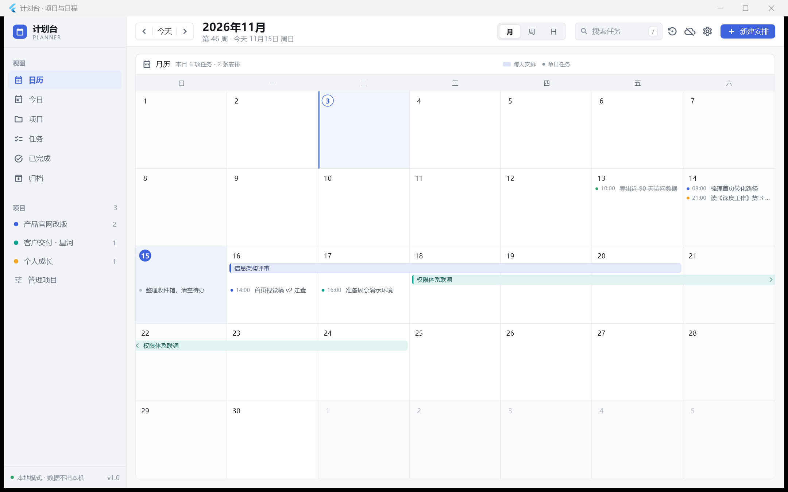

# PlanTai v2.0.0 — First Cross-Platform Release

计划台 v2.0.0 是第一个同时提供 **Windows / Ubuntu / Android** 三个平台安装包的公开发布版本。

PlanTai v2.0.0 is the first public release shipping **Windows, Ubuntu and Android** builds.



---

## 本次内容 / What's new

- **三平台首发**：Windows x64 便携包、Ubuntu amd64 `.deb`、Android arm64-v8a 正式签名 APK。
- **Ubuntu 桌面端**：GTK3 + Flutter Linux 工程，`.deb` 安装到 `/opt/jihuatai`，
  数据保存在 `~/.local/share/计划台/data/`，升级/卸载不删数据。
- **Android 手机端**：月历、每日面板、项目页、我的分区；横竖屏与平板三栏自适应；
  登录令牌经 Android Keystore（AES-256-GCM）加密保存。
- **移动端云同步**：与桌面端使用同一套 PocketBase 协议与数据模型，可双向增量同步。
- **自动发布流水线**：GitHub Actions 完成代码检查、三平台构建、SHA-256 校验与 Release 上传。

## 下载 / Downloads

| 平台 | 文件 |
|---|---|
| Windows 10/11 x64 | `PlanTai-2.0.0-Windows-x64.zip` |
| Ubuntu 22.04 / 24.04 amd64 | `PlanTai-2.0.0-Ubuntu-amd64.deb` |
| Android 7.0+ arm64-v8a | `PlanTai-2.0.0-Android-arm64-v8a.apk` |
| 校验值 | `SHA256SUMS.txt` |

下载后请先校验（可选但推荐）：

```bash
sha256sum -c SHA256SUMS.txt      # Linux
Get-FileHash .\PlanTai-2.0.0-Windows-x64.zip -Algorithm SHA256   # Windows PowerShell
```

## 安装说明

**Windows**：解压 `PlanTai-2.0.0-Windows-x64.zip` 到任意目录，双击 `jihuatai.exe`。
不要只复制 exe —— 同目录的 `flutter_windows.dll` 与 `data\` 是运行必需。
首次启动在 `%APPDATA%\计划台\data\` 建库，空界面属正常。

**Ubuntu**：

```bash
sudo apt install ./PlanTai-2.0.0-Ubuntu-amd64.deb
jihuatai
```

安装后可在应用菜单搜索「计划台」。无密钥环时云同步会提示不可用，本地功能不受影响。

**Android**：安装 `PlanTai-2.0.0-Android-arm64-v8a.apk`（需允许未知来源安装）。
使用正式签名，后续同签名更高版本可直接覆盖升级，数据保留。

## 云同步（可选）

不登录即为纯本地离线模式。需要多设备同步时：

1. 自行部署 PocketBase 0.23.12 服务端（代码见 `server/`，部署方案见 `docs/DEPLOYMENT.md`）；
2. 应用内点顶栏云图标 → 填服务器地址 / 邮箱或用户名 / 密码 → 登录；
3. 首次绑定按向导选择数据归属（上传本机 / 以云端为准 / 暂不关联），**不会自动上传**。

## 已知限制 / Known limitations

- 浏览器（Web）版本尚未提供。
- 云同步需要自建服务端，官方不提供托管服务。
- Windows 版为便携 zip，不是安装器；Ubuntu 主要支持 22.04/24.04 amd64。
- Android 提供 arm64-v8a 与 x86_64 包（`-Android-armeabi-v7a.apk` 视构建情况附带），
  无通用 universal 包。
- 移动端暂不支持手动合并冲突（只能选择保留本机或云端版本）。

## 升级注意事项

- Windows / Ubuntu：解压新版本或安装新 `.deb` 即可，用户数据保持在原位置。
- Android：直接覆盖安装同签名更高 `versionCode` 的 APK；数据保留。
- 若此前安装过 debug 签名的测试包，需要先卸载再安装正式签名包（签名不同无法覆盖）。
