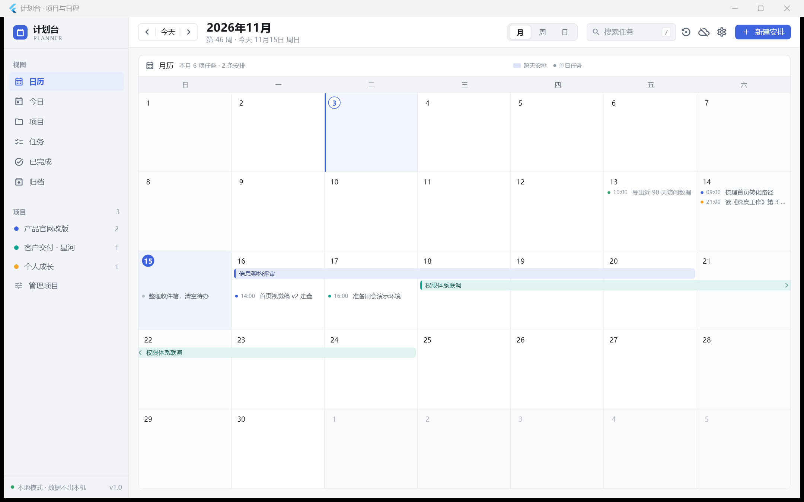
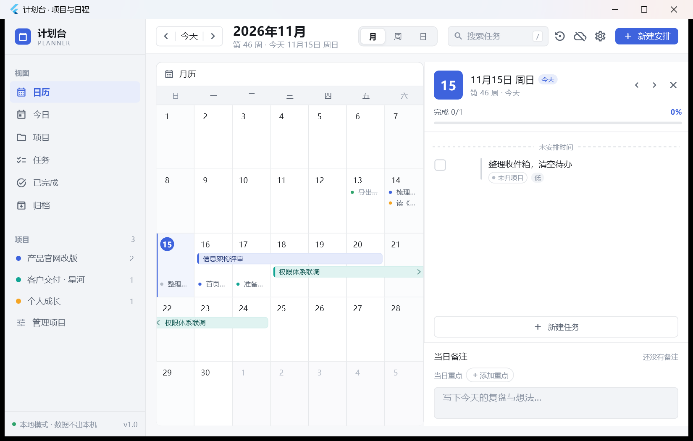
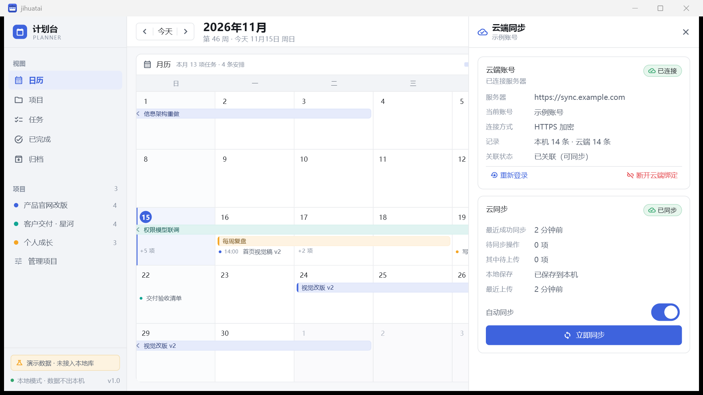
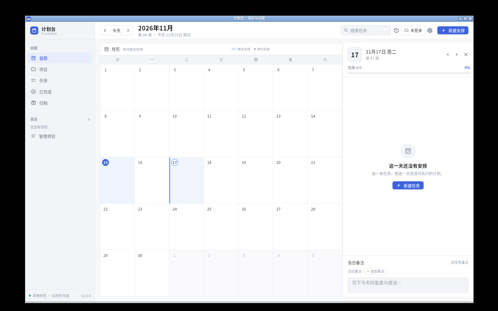
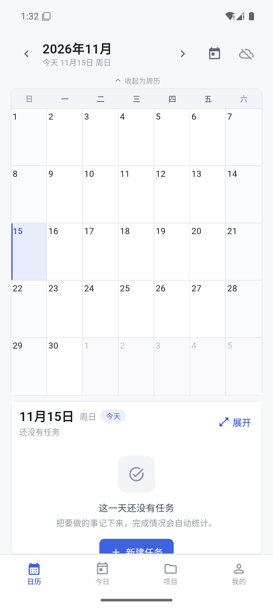

# 计划台 · PlanTai

> 一款**本地优先（local-first）**的跨平台个人项目与日程管理软件。
> 以「月历」为唯一主视图：项目是颜色来源，任务是某一天的一件事，跨天阶段是月历上的彩条。
> 本地 SQLite 存储、离线可用，可选登录**自建** PocketBase 服务器实现多设备双向同步。

[English README](README_EN.md) · [更新记录](CHANGELOG.md) · [贡献指南](CONTRIBUTING.md) · [安全说明](SECURITY.md)

支持的平台：**Windows 10/11 (x64)** · **Ubuntu 22.04 / 24.04 (amd64)** · **Android 7.0+**



---

## 1. 它解决什么问题

大多数日历 / 任务工具要么把「项目」和「日历」割裂成两个应用，要么把你的数据放在别人的云上。
计划台把这两件事放到同一个界面里，并且**默认不联网**：

- 项目有颜色，月历上每一天的任务自动归属到项目颜色，一眼看清时间花在哪些事情上。
- 一个项目可以横跨多天，在月历上表现为连续彩条（跨日期阶段车道），不会把一件事拆成十天的重复条目。
- 双击任意一天，右侧滑出当日面板：时间轴上的任务、未安排事项、当日备注、当日重点都在这里完成。
- 数据存在本机 SQLite 里，断网、停机、服务端变更都不影响使用。
- 想要多设备同步时，再自行部署一个 PocketBase 服务器（服务端代码在本仓库 `server/`）。

## 2. 核心功能

### 月历主页

- 周一起始，补齐相邻月份的整周；今天 / 选中 / 非本月三档样式。
- 跨天阶段车道：按周分段、首尾圆角、延续指示、超出折叠。
- 单日任务按项目颜色显示，任务多时自动折叠并可展开。



### 每日任务面板

- 时间轴排序，未安排时间的任务单独分组。
- 任务新增 / 修改 / 删除 / 完成勾选，与「已完成」列表双向同步。
- 时间重叠提示、当日备注、当日重点。
- 删除任务后可撤销恢复。

### 项目管理

- 新建 / 改名 / 简介 / 颜色 / 状态 / 归档 / 删除（级联删除其下任务）。
- 长按拖动调整项目顺序，侧栏同步。
- 跨日期阶段可直接新增、编辑、删除。

### 本地数据与备份

- 本地 SQLite（WAL 模式），首次启动自动建库，重启数据完整。
- JSON 导出备份、从备份恢复；恢复前自动生成 SQLite 快照，失败自动回滚。
- 数据目录可用环境变量 `JIHUATAI_DATA_DIR` 覆盖，便于便携使用或隔离测试。

### 可选：云端账号与多设备同步

- 登录你**自己的** PocketBase 服务器（HTTPS；本机调试允许 `http://127.0.0.1`）。
- 首次绑定有向导：本机有数据 / 云端有数据 / 两边都有 / 已绑定其他账号，逐场景确认，**不会自动上传**。
- 双向同步：本地写入 → outbox 同事务入队 → push（opId 幂等 + 版本冲突）→ pull 增量。
- 冲突保留双方版本，用户选择保留本机或云端。
- 自动同步：登录后启动、本地改动 2 秒防抖、每 5 分钟、失败指数退避。
- 登录令牌只进系统安全存储（Windows 凭据管理器 / Linux Secret Service / Android Keystore），
  **不写入 SQLite、JSON 或日志**。



## 3. 下载与安装

最新版本请到 [**Releases**](../../releases/latest) 页面下载，每个版本都附带 `SHA256SUMS.txt`，
下载后建议先校验：

```bash
# Windows (PowerShell)
Get-FileHash .\PlanTai-<版本>-Windows-x64.zip -Algorithm SHA256

# Linux
sha256sum PlanTai-<版本>-Ubuntu-amd64.deb
```

### Windows

1. 下载 `PlanTai-<版本>-Windows-x64.zip` 并解压到任意目录（**不要只复制 exe**，
   同目录的 `flutter_windows.dll` 与 `data\` 是运行必需）。
2. 双击 `jihuatai.exe` 启动。
3. 首次启动会在 `%APPDATA%\计划台\data\` 建库，界面为空态属正常。

系统要求：Windows 10 / 11 x64，无需另装运行库（Flutter 运行库随包）。
卸载：删除解压目录；如需删除个人数据，另行删除 `%APPDATA%\计划台`。

### Ubuntu / Debian 系

```bash
sudo apt install ./PlanTai-<版本>-Ubuntu-amd64.deb
jihuatai
```

- 程序安装到 `/opt/jihuatai/`，命令行入口 `/usr/bin/jihuatai`，并注册应用菜单图标。
- 用户数据位于 `~/.local/share/计划台/data/`；**升级 / 卸载都不会删除用户数据**。
- 依赖系统自带的 GTK3 / SQLite / libsecret；无密钥环时会提示且保持离线可用（不落明文）。



### Android

1. 下载 `PlanTai-<版本>-Android-arm64-v8a.apk`（主流手机）。
2. 手机允许「安装未知来源应用」后安装。
3. 已用正式签名打包；同签名 + 更高 `versionCode` 的后续版本可直接覆盖升级，数据保留。

- 最低 Android 7.0；x86_64 包供模拟器/平板使用。
- 登录令牌使用 Android Keystore（AES-256-GCM）加密保存，不落明文。



## 4. 数据保存在哪里

| 内容 | Windows | Ubuntu | Android |
|---|---|---|---|
| 本地数据库 | `%APPDATA%\计划台\data\app.db` | `~/.local/share/计划台/data/app.db` | 应用私有目录 `files/data/app.db` |
| 账号工作区 | `...\data\accounts\<ownerId>\app.db` | `.../data/accounts/<ownerId>/app.db` | 同左（应用私有目录） |
| 本地备份 | `...\data\backups\*.json` | `.../data/backups/*.json` | 同左 |
| 登录令牌 | Windows 凭据管理器（DPAPI） | Secret Service（GNOME Keyring / KWallet） | Android Keystore |

**卸载软件不会自动删除用户数据**；要彻底清除，请手动删除上表对应的数据目录。

## 5. 从源码构建

需要 [Flutter 3.50.0](https://flutter.dev)（Dart 3.14）。桌面端构建要求对应平台的原生工具链：

- Windows：Visual Studio 2022/2026（含「使用 C++ 的桌面开发」工作负载）
- Ubuntu：`clang cmake ninja-build pkg-config libgtk-3-dev liblzma-dev libsqlite3-dev`
- Android：Android SDK + JDK 21

```bash
flutter pub get
flutter analyze        # 必须 0 issue
flutter test           # 单元 / Widget 测试
flutter build windows --release   # Windows
flutter build linux   --release   # Ubuntu（必须在 Linux 主机上执行）
flutter build apk     --release   # Android
```

- Linux 的 `.deb` 在 `flutter build linux --release` 之后执行
  `bash packaging/linux/build_deb.sh`（详见 [packaging/linux](packaging/linux)）。
- Android 正式签名：把 keystore 放在仓库之外的目录，用 `android/key.properties`
  指向它（示例见 `android/key.properties.example`）。**密钥与密码绝不入库**；
  缺失时 Gradle 会回退 debug 签名并打印警告，这种包不能发布。
- 构建目录请使用**纯 ASCII 路径**：Flutter 在部分非 ASCII 路径下会出现构建失败，
  Android Gradle Plugin 会直接拒绝非 ASCII 工程路径。

### GitHub Actions

| 工作流 | 触发 | 作用 |
|---|---|---|
| [`CI`](.github/workflows/ci.yml) | push 到 `main` / PR / 手动 | `flutter analyze` + `flutter test` |
| [`Release`](.github/workflows/release.yml) | 推送 `v*` 标签 / 手动 | 三平台构建 → SHA-256 → 创建 Release 并上传 |

发布流程：修改 `pubspec.yaml` 版本 → 本地验证 → 打标签
（例如 `git tag v2.0.0 && git push origin v2.0.0`）→ Actions 自动构建并创建 Release。
Android 正式签名通过仓库 Secrets（`ANDROID_KEYSTORE_BASE64`、`ANDROID_KEYSTORE_PASSWORD`、
`ANDROID_KEY_ALIAS`、`ANDROID_KEY_PASSWORD`）注入；未配置时会跳过 Android 任务，
**不会**用 Debug 签名包冒充正式包。

## 6. 目录结构

```
lib/
├─ main.dart                 启动：工作区解析、仓储装配、云服务装配
├─ app/                      桌面外壳：侧栏、顶栏、导航、项目管理页、设置、备份
├─ core/                     模型、仓储契约、主题令牌、云契约与测试假件
├─ features/calendar/        月历：整周网格、跨天阶段车道、单日任务折叠
├─ features/day_detail/      每日任务面板：时间轴、编辑器、当日备注
├─ features/cloud_account/   云账号 / 同步状态 / 绑定 / 冲突 UI
├─ mobile/                   Android 移动端界面（月历 / 每日 / 项目 / 我的）
├─ data/                     SQLite 仓储、迁移、备份恢复
├─ data/cloud/               平台相关的凭证存储、PocketBase 认证、HTTP 协议客户端
└─ data/sync/                outbox、push/pull、冲突、绑定、自动同步
server/                      PocketBase 服务端（pb_hooks + pb_migrations）
packaging/                   Linux .deb 打包脚本与桌面图标
scripts/                     开发、构建、E2E 与环境脚本
test/                        单元 / Widget / 集成测试
docs/                        架构、契约、平台说明、部署与用户文档
```

## 7. 自建云同步服务器（可选）

服务端是一个 PocketBase 0.23.12 应用（`server/pb_hooks` + `server/pb_migrations`），
只在 `/api/planner/*` 暴露业务接口，业务表为 `pa_*`，owner 一律取自认证身份。

- 本地开发：见 [server/README.md](server/README.md)。
- 生产部署（Caddy + systemd + 备份）：见 [docs/DEPLOYMENT.md](docs/DEPLOYMENT.md)。
- 协议与安全边界：见 [docs/sync/API_CONTRACT.md](docs/sync/API_CONTRACT.md)、
  [docs/sync/SECURITY.md](docs/sync/SECURITY.md)。

> 官方不提供托管同步服务；不登录时软件 100% 离线可用。

## 8. 隐私与数据安全

- 本项目**不包含**任何真实用户数据、真实服务器地址、密钥或令牌；仓库内示例数据均为虚构。
- 应用**没有**内置任何统计 / 埋点 / 崩溃上报 SDK。
- 唯一的网络行为是：你主动配置并登录云端同步时，访问你填写的服务器地址。
- 数据默认只在本机；同步文件夹的备份与导出由你自己掌控。
- 安全策略与漏洞报告方式见 [SECURITY.md](SECURITY.md)。

## 9. 常见问题

**Q：为什么 Windows 版是 zip 而不是安装器？**
A：Flutter 桌面版本身就是「exe + DLL + data 目录」的便携结构，zip 解压即用、不需要管理员权限，
也不会写注册表。卸载只需删除目录。

**Q：数据会不会被上传？**
A：不会。只有你主动登录你自己部署的服务器并确认绑定后，才会同步。首次绑定向导默认不会自动上传。

**Q：能否不登录就用？**
A：可以。不登录 / 断网时所有本地功能完全可用，登录是可选项。

**Q：Android 安装时提示签名不一致？**
A：请卸载旧的调试包再安装正式签名包。正式签名包之间可以正常覆盖升级。

**Q：Linux 下提示找不到密钥环？**
A：安装并解锁 `gnome-keyring` 或 `kwallet`（`libsecret-tools` 作为 Recommends 提供 `secret-tool`）。
无密钥环时云同步会提示不可用，本地功能不受影响，也不会把令牌写成明文。

**Q：为什么应用叫 jihuatai 而不是 PlanTai？**
A：`PlanTai` 是对外名称；`jihuatai` 是项目内部的稳定标识（Android `applicationId` `com.jihuatai.planner`、
包名与数据目录）。改动它会导致已有安装无法覆盖升级，因此保持冻结。

## 10. 更新记录与许可证

- 版本变更见 [CHANGELOG.md](CHANGELOG.md)。
- 许可证：见 [LICENSE](LICENSE)（发布前由项目作者确认最终协议）。
- 第三方依赖均为宽松许可证（MIT / BSD-3-Clause / Apache-2.0）；Flutter 与 Material 图标遵循各自协议。
  分发二进制时请保留 `NOTICES` 文件（构建产物 `data/flutter_assets/NOTICES.Z` 内已包含）。

## 11. 参与开发

欢迎提交 Issue / PR，请先阅读 [CONTRIBUTING.md](CONTRIBUTING.md)。

---

**项目状态**：个人项目，按实际需要持续迭代；功能以代码与构建结果为准。
