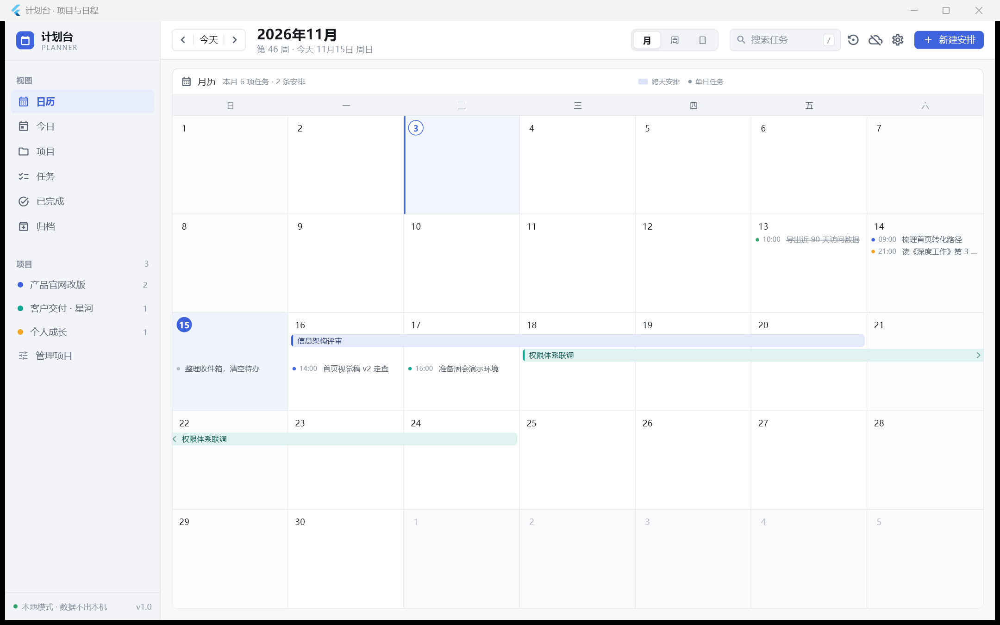
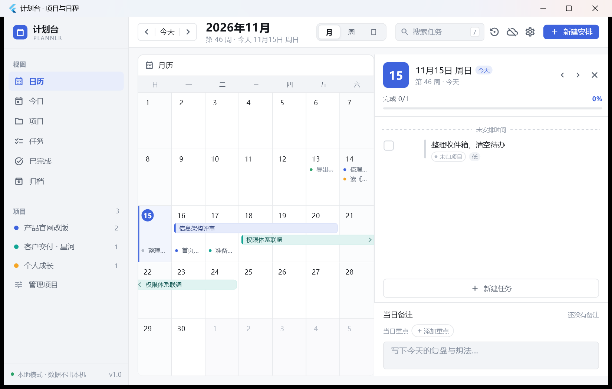
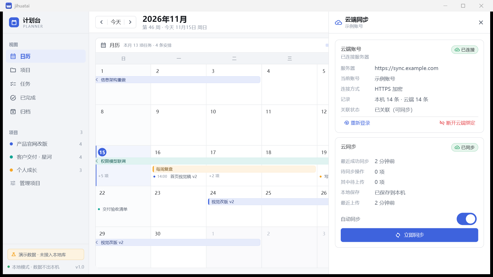

# PlanTai · 计划台 (English)

> A **local-first**, cross-platform personal project & schedule manager built with Flutter.
> The month calendar is the single main view: projects provide colors, a task is one thing on
> one day, and multi-day project phases appear as continuous bars on the calendar.
> Data lives in a local SQLite database and works fully offline. Optionally sign in to your
> **self-hosted** PocketBase server to sync across devices.

[中文 README](README.md) · [Changelog](CHANGELOG.md) · [Contributing](CONTRIBUTING.md) · [Security](SECURITY.md)

Platforms: **Windows 10/11 (x64)** · **Ubuntu 22.04 / 24.04 (amd64)** · **Android 7.0+**



## Features

- **Month calendar** — Monday-first, adjacent-month weeks completed, distinct styling for
  today / selected / out-of-month days; multi-day "phase lanes" with per-week segments,
  rounded ends, continuation markers and overflow folding.
- **Day panel** — a timeline of tasks, an "unscheduled" group, create/edit/delete/complete,
  overlap hints, daily note and daily focus; undo after delete.
- **Project management** — create / rename / description / color / status / archive /
  cascade delete, drag to reorder, phases editable directly on the calendar.
- **Local data & backup** — SQLite (WAL), JSON export, restore with a pre-restore snapshot
  and automatic rollback on failure. Data directory can be overridden with `JIHUATAI_DATA_DIR`.
- **Optional cloud sync** — sign in to your own PocketBase 0.23.12 server over HTTPS:
  guided first-time binding (never auto-uploads), local-first writes with an outbox,
  idempotent push (`opId`) with version conflicts, incremental pull, exponential backoff,
  offline-safe. Tokens are stored only in the OS secure storage (Windows credential
  manager / Linux Secret Service / Android Keystore) — never in SQLite, JSON or logs.
- **Android UI** — dedicated mobile calendar / day panel / projects / "Me" sections,
  responsive for phone and tablet layouts.




## Download & install

Get the latest build from [Releases](../../releases/latest); every release ships
`SHA256SUMS.txt`.

- **Windows** — unzip `PlanTai-<version>-Windows-x64.zip` (keep the `data` folder and DLLs
  next to the exe) and run `jihuatai.exe`. No runtime installation required.
- **Ubuntu** — `sudo apt install ./PlanTai-<version>-Ubuntu-amd64.deb`, then run `jihuatai`.
  User data lives in `~/.local/share/计划台/data/` and is kept on upgrade/uninstall.
- **Android** — install `PlanTai-<version>-Android-arm64-v8a.apk`. Release builds are signed
  with a stable release key, so later versions upgrade in place and keep data.

## Where data is stored

| Data | Windows | Ubuntu | Android |
|---|---|---|---|
| Local DB | `%APPDATA%\计划台\data\app.db` | `~/.local/share/计划台/data/app.db` | app-private `files/data/app.db` |
| Backups | `...\data\backups\*.json` | `.../data/backups/*.json` | same |
| Auth token | Windows Credential Manager | Secret Service | Android Keystore |

Uninstalling never deletes user data; remove the directories above manually if you want to.

## Build from source

Requires Flutter 3.50.0 (Dart 3.14) plus the native toolchain of the target platform
(Visual Studio with C++ workload on Windows, `clang`/`cmake`/`ninja`/`libgtk-3-dev` on
Ubuntu, Android SDK + JDK 21 for Android).

```bash
flutter pub get
flutter analyze          # must report zero issues
flutter test
flutter build windows --release
flutter build linux   --release   # Linux host only
flutter build apk     --release
```

- `.deb` packaging: `bash packaging/linux/build_deb.sh` after the Linux release build.
- Android release signing reads `android/key.properties` (see
  `android/key.properties.example`); keys never enter the repository. Without it Gradle
  falls back to debug signing and warns — such APKs must not be published.
- Build in an **ASCII-only** path: AGP rejects non-ASCII project paths.

### CI / Release automation

| Workflow | Trigger | Purpose |
|---|---|---|
| [`CI`](.github/workflows/ci.yml) | push to `main`, PR, manual | analyze + test |
| [`Release`](.github/workflows/release.yml) | `v*` tag, manual | build all three platforms, generate SHA-256 sums, create the GitHub Release |

Bump `pubspec.yaml`, then push a matching tag (e.g. `v2.0.0`). Android signing secrets
(`ANDROID_KEYSTORE_BASE64`, `ANDROID_KEYSTORE_PASSWORD`, `ANDROID_KEY_ALIAS`,
`ANDROID_KEY_PASSWORD`) are injected by CI; when they are missing the Android job is
skipped instead of publishing a debug-signed build.

## Self-hosted sync server (optional)

`server/` contains a PocketBase 0.23.12 application exposing only `/api/planner/*` custom
routes over `pa_*` tables, with ownership always derived from the authenticated identity.
See [server/README.md](server/README.md) for local setup and
[docs/DEPLOYMENT.md](docs/DEPLOYMENT.md) for production deployment (Caddy + systemd).
There is no official hosted sync service; without signing in the app is fully offline.

## Privacy

- The repository contains **no** real user data, server addresses, keys or tokens;
  all sample data is fictional.
- The app has no analytics, telemetry or crash-reporting SDK. The only network traffic is
  to the server address **you** configure for optional sync.

## License

This project is licensed under the [MIT License](LICENSE). Third-party dependencies are permissively licensed
(MIT / BSD-3-Clause / Apache-2.0); Flutter and the Material icon font keep their own
licenses (see the `NOTICES` file bundled with each build).
